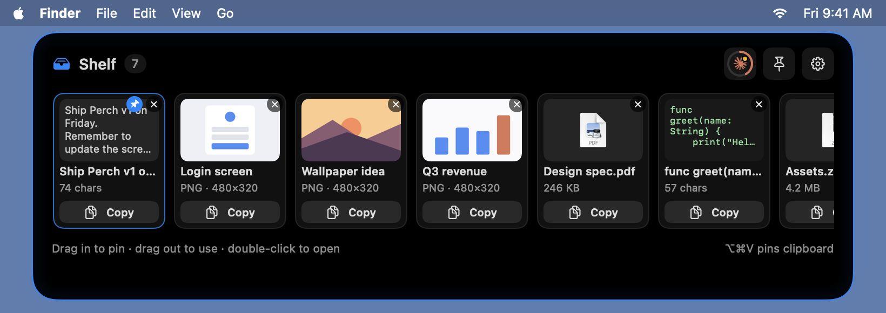
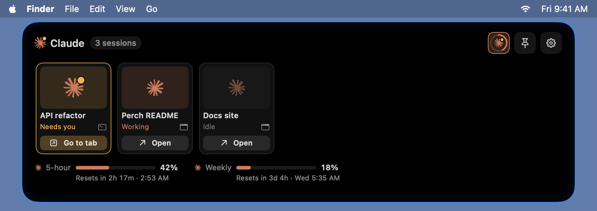
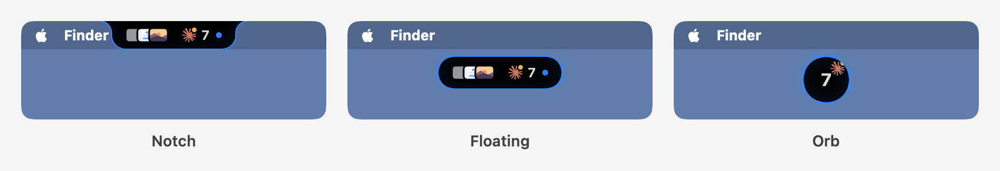
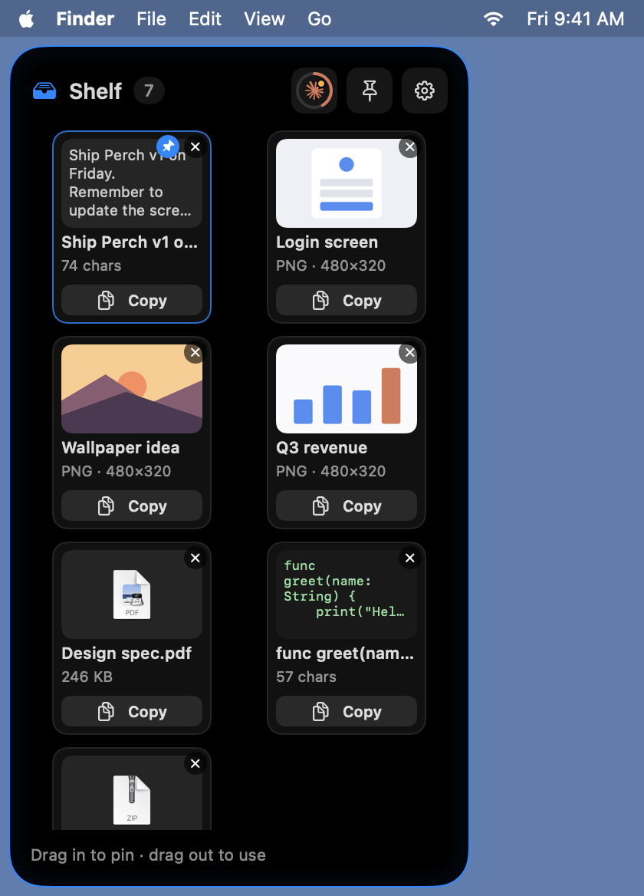

# Perch



A Dynamic Island–style shelf for the MacBook notch. Pin screenshots, text and files
at the top of the screen so you can copy or drag them into any app without
switching windows.

## Screenshots


**Hover or click to open the shelf.** Your latest screenshots, text and files as cards, newest first. Pinned cards stay at the front.



**Claude view.** Click the Claude logo for your running Claude Code sessions and plan usage. The ring around the logo shows 5-hour usage at a glance.



**Styles and placement.** Notch, Floating (the default) or Orb, on the top, left or right edge. Floating and Orb can be dragged anywhere, even onto another display.





<sub>Screenshots are drawn from the app's own views with sample data: `build/Perch.app/Contents/MacOS/Perch --render-screenshots docs/screenshots`.</sub>

## Features

- **Small island by default.** A compact pill around the notch shows your latest items and a count.
- **Hover to expand.** Move the cursor onto the pill and it springs open with a wobble. Move away and it shrinks back.
- **Drag in, drag out.** Drop screenshots, files or text onto the island. Drag cards out into Slack, Mail, an editor, anywhere.
- **Newest first, scroll for more.** Compact cards in a sideways-scrolling row. The edges fade and an arrow shows how many more cards are hidden. Trackpad swipes and the mouse wheel both scroll it.
- **Fix a card's position.** Hover a card and click the pin, or right-click and choose Fix at the Front. Fixed cards stay at the front and never expire.
- **Optional filter tabs.** By default the shelf shows everything. Turn on Settings → Shelf → Show filter tabs to get All, Images, Text, Files and Recent (a dropdown in the side panel).
- **Add to Perch from any app.** Select text, an image or files, right-click → Services → **Add to Perch** (also in the app menu → Services). If it isn't listed, turn it on in System Settings → Keyboard → Keyboard Shortcuts → Services → Text / Files and Folders.
- **Stays out of your movies.** While a full-screen video plays (Netflix, YouTube, Apple TV, VLC…), the island hides, and it comes back when you pause or leave full screen. Other full-screen apps keep it. Turn this off in Settings → Placement.
- **Quick search.** Press ⌥⌘F from anywhere (or 🔍 in the shelf) and type: cards filter by title, text and file name. Return copies the first match; Esc clears, then closes.
- **Select, preview, drag several.** Click a card to select it, ⌘-click to add more, ⇧-click for a range. Press Space for Quick Look (arrow keys step through the selection). Drag any selected card and they all come along. Right-click for Copy / Remove all.
- **Copy with one click.** Every card has a Copy button; double-click opens images and files.
- **Auto-catch screenshots and screen recordings.** New screenshots (⌘⇧3 / ⌘⇧4 / ⌘⇧5) and screen recordings (⌘⇧5) land on the shelf automatically. Recordings are referenced in place (not copied) and show a video frame, a ▶ badge and their length. File cards show a real preview of the file (video frame, PDF page…). Perch watches the folder screenshots are saved to (Screenshot app → Options → Save to), so allow access when macOS asks for that folder.
- **Clipboard history (optional).** Turn on Settings → Capture → "Add everything you copy to the shelf" and copied text, images and files land on it too (last 30 in the Recent tab). It's off by default so the shelf only holds what you add on purpose; ⌥⌘V pins whatever is on the clipboard any time.
- **Secret blur.** Text that looks like an API key, token, private key or card number is blurred until you click it.
  Copies from password managers are never recorded.
- **Claude Code sessions.** A small Claude mark on the island shows your running Claude Code sessions: it spins while one is working, pulses amber when one needs you, and is grey when they're idle. Open the island and click the Claude logo at the top right to switch the cards to your sessions, with full usage meters at the bottom (click it again to go back to the shelf). The ring around the logo fills with your 5-hour usage, so you can check it without switching. Clicking a desktop-app session opens it in the Claude app. Clicking a terminal session brings its terminal to the front and selects the exact tab in Terminal and iTerm2 (macOS asks once for permission). Right-click a terminal session to open a copy in the Claude app. Status comes from `~/.claude/sessions/`, an undocumented format that a Claude update could change. Turn off just this in Settings → Claude Code, or switch off Show Claude to hide everything Claude.
- **Claude plan usage.** The Claude view shows your 5-hour and weekly limits in Claude orange: percent used, with a live countdown to each reset underneath its bar. The numbers come from a Claude Code status line script, `scripts/claude-statusline.sh`, installed to `~/.claude/perch/statusline.sh` and set as `statusLine` in `~/.claude/settings.json`. It updates whenever a Claude Code session gets a reply. When those numbers are missing or older, the row falls back to the Claude app's own usage history, which it only samples now and then; numbers older than an hour show greyed out with "as of". Turn off just this in Settings → Claude Code, or switch off Show Claude to hide everything Claude.
- **Position and style.** In Settings → Placement, put the island on the top, left or right edge, and pick a style: Notch (joined to the edge), Floating (a capsule, the default) or Orb (a circle with the item count). Both can be dragged anywhere: drag the capsule or orb, or the open shelf by its header. With more than one display, drag it across to another screen. Perch remembers the screen and the spot, falls back to the main screen if that display is disconnected, and Settings → Reset position moves it back. Notch always stays on the built-in (notched) or main screen. Left and right open a tall side panel with a 2-column card grid that scrolls down. Clicking the collapsed island opens it.
- **Looks.** Solid, Transparent or Glass background; None, Hairline, Accent, Glow, Double or Pulse outline in five colors.
  The island curves out into the top edge of the screen like the system notch.
- **Cleanup.** Unstarred items expire after 1 day / 3 days / 1 week (or never). Star an item to keep it.
- Works on Macs with and without a notch. With a notch (top position, Notch style) the island wraps around it; without one it becomes a small pill in the middle of the menu bar. If you close the lid or connect an external display, it moves to the right screen.

## Shortcuts

All of these are also in the app: menu bar bird → **Keyboard Shortcuts…**, Settings → General → **Show All Shortcuts…**, or press **?** in the open shelf.

| Shortcut | Action |
| --- | --- |
| ⌥ Space | Keep the island open / let it close |
| ⌥ ⌘ V | Pin whatever is on the clipboard |
| ⌥ ⌘ F | Search the shelf (Return copies the first match, Esc clears) |
| Click / ⌘-click / ⇧-click a card | Select it / add to selection / select a range |
| Space | Quick Look the selected cards |
| ⌘A / ⌘C / Esc | Select all / copy selection / clear selection (Esc again closes the shelf) |
| ? | Show all keyboard shortcuts (in the open shelf) |
| Right-click a card | Quick Look, Copy, Open, Show in Finder, Pin, Fix at the Front, Star, Remove (and "… N Items" for a selection) |

## Install

Needs macOS 13 or newer and Swift 5.9+ (Xcode 15+, or just the Command Line Tools: `xcode-select --install`).

1. **Clone the repo** anywhere you like:

   ```bash
   git clone https://github.com/anaydas/perch.git
   cd perch
   ```

2. **Install** (builds Perch, copies it to `/Applications` and opens it):

   ```bash
   ./scripts/install.sh
   ```

   Or, to also get the **Claude plan usage meters** (5-hour and weekly limits, and the ring around the Claude logo):

   ```bash
   ./scripts/install.sh --with-claude-usage
   ```

3. **Allow access** when macOS asks for your **Documents** or **Desktop** folder (that's where screenshots are
   saved), and later for **Terminal/iTerm2** when you first click a terminal Claude session.

4. **Optional:** turn on **Launch at login** in Perch → Settings → General.

The scripts find the repo from their own location, so you can run them from any folder
(for example `~/code/perch/scripts/install.sh`).

To get new versions later, run `./scripts/update.sh` (see [Update](#update)).

### Claude Code sessions and usage

- **Sessions** need no setup: start a Claude Code session (in the Claude app or with `claude` in a terminal),
  open the shelf and click the Claude logo next to "Shelf".
- **Usage meters** come from a Claude Code status line. `--with-claude-usage` copies
  `scripts/claude-statusline.sh` to `~/.claude/perch/statusline.sh` and sets it as `statusLine` in
  `~/.claude/settings.json` (your settings are backed up to `~/.claude/perch/settings.backup.json` first; a status
  line of your own is left alone). To see live numbers, start a **new** `claude` session and send any message.
  Terminal sessions update it for sure; the Claude app's Code tab may not run status lines, in which case Perch
  falls back to the Claude app's own (occasional) usage history.

## Update

To get the latest version, run this from the folder you cloned Perch into:

```bash
./scripts/update.sh
```

It fetches the latest `main` from GitHub, lists what's new, and reinstalls Perch. Your shelf items and settings are
kept, and if you set up the Claude usage meters, they're refreshed too. If there's nothing new, it says so and skips
the rebuild. A typical run:

```text
→ Fetching the latest main…
New changes:
  • Clipboard capture off by default (Settings → Capture)
  • Add update script (pull latest main and reinstall)
✓ Updated to c165cbd
→ Building Perch…
✓ Built
→ Installing to /Applications…
✓ Installed /Applications/Perch.app
```

- `--force` reinstalls even when there's nothing new.
- `--branch` updates the branch you're on instead of requiring `main`.

**If it stops**, it hasn't changed anything. It tells you why:

| Message | What to do |
|---|---|
| You have uncommitted changes | Commit them, or set them aside with `git stash` (bring them back later with `git stash pop`), then run it again |
| You're on branch '…', not main | `git switch main`, or update the current branch with `./scripts/update.sh --branch` |
| Your local main has commits that aren't on GitHub | `git push` them first (or sort out the branch with git), then run it again |

## Reinstall from scratch (with Claude meters)

1. **Uninstall everything** (app, shelf items, settings, status line, permissions):

   ```bash
   ./scripts/uninstall.sh --yes
   ```

   To keep your shelf items and settings, use `./scripts/uninstall.sh --yes --keep-data` instead.

2. **Install again, with the usage meters:**

   ```bash
   ./scripts/install.sh --with-claude-usage
   ```

3. **Allow access** again when macOS asks (Documents/Desktop, Terminal/iTerm2): a fresh install starts over.

4. **Start a new `claude` session and send any message**: the meters appear in the Claude view once Claude Code
   has your limits.

Steps 1 and 2 in one go:

```bash
./scripts/uninstall.sh --yes && ./scripts/install.sh --with-claude-usage
```

## Uninstall

From the folder you cloned Perch into:

```bash
./scripts/uninstall.sh
```

It lists what it will remove and asks before doing anything. It turns off Launch at login, quits Perch, deletes the app,
your shelf items and settings, the Claude Code status line Perch added (only if it's Perch's; your previous
`settings.json` is saved next to it), and resets Perch's privacy permissions. Your source code is left alone.

- `--keep-data` keeps your shelf items and settings, for a reinstall later.
- `--yes` skips the question.

To install again afterwards, see [Reinstall from scratch](#reinstall-from-scratch-with-claude-meters).

<details>
<summary>Uninstall by hand</summary>

1. **Turn off Launch at login** if you enabled it: Perch Settings → General, or System Settings → General → Login Items.
2. **Quit Perch**: menu bar bird → Quit Perch, or:

   ```bash
   pkill -x Perch
   ```

3. **Delete the app** (and your local build, if you built it):

   ```bash
   rm -rf /Applications/Perch.app build   # run from the folder you cloned perch into
   ```

4. **Delete your shelf items and settings.** This removes everything on the shelf for good:

   ```bash
   rm -rf ~/Library/Application\ Support/Perch
   defaults delete com.anaydas.Perch
   ```

   If you used it back when it was called Notch Shelf, also run `defaults delete com.anaydas.NotchShelf`.

5. **Remove the Claude Code status line** (only if you set up Claude usage). Open `~/.claude/settings.json`, delete the
   `"statusLine": { ... }` entry (and the comma before it), then remove the script folder:

   ```bash
   rm -rf ~/.claude/perch
   ```

   That folder also holds `settings.backup.json`, a copy of your Claude settings from before the status line was added.
   Look at it first if you want to compare, but don't restore it over newer settings.

6. **Remove its privacy permissions** (Documents/Desktop folder access, Terminal/iTerm2 control):

   ```bash
   tccutil reset All com.anaydas.Perch
   ```

   Or remove Perch by hand in System Settings → Privacy & Security → Files and Folders and → Automation.

</details>

## Notes

- The app has no Dock icon. Look for the little bird in the menu bar (Settings, Quit) and the island at the notch.
- **Building from source works on any Mac** (macOS 13+ with Swift 5.9+): clone, run `./scripts/install.sh`, done.
- **Sharing the built `Perch.app`:** it's signed locally ("ad-hoc"), so on another Mac, macOS blocks it at first.
  Open it once via System Settings → Privacy & Security → **Open Anyway**, or run
  `xattr -dr com.apple.quarantine /Applications/Perch.app`. Opening without that step for everyone needs an
  Apple Developer account to sign and notarize it.
- **Intel and Apple silicon:** `install.sh` builds for the Mac it runs on, so it's always native. To share one
  pre-built app that runs natively on both, build it with `./scripts/build-app.sh --universal`.

## Development

### Build without installing

```bash
./scripts/build-app.sh               # builds build/Perch.app for this Mac's processor
./scripts/build-app.sh --universal   # Intel + Apple silicon in one app (slower; for sharing)
open build/Perch.app                 # try it
```

To work on it in Xcode: `open Package.swift`, pick the **Perch** scheme and press ⌘R.

## Project layout

```
Sources/Perch/
  App/          entry point, app delegate, menu bar icon
  Models/       ShelfItem, AppSettings
  Services/     ShelfStore (items + files), clipboard & screenshot watchers, Claude session & usage watchers,
                hot keys, secret detector
  Island/       panel, layout for each position/style, hover and drag logic, island shape, SwiftUI views
  Settings/     settings window
Resources/Info.plist, AppIcon.icns, AppIcon-1024.png
scripts/install.sh         build, install to /Applications, open (--with-claude-usage for the meters)
scripts/update.sh          pull the latest main and reinstall
scripts/build-app.sh       build build/Perch.app (--universal for Intel + Apple silicon)
scripts/uninstall.sh       remove Perch from this Mac
scripts/make-icon.swift    draw the app icon (Resources/AppIcon.icns)
scripts/claude-statusline.sh  Claude Code status line that saves plan usage for Perch
```

Data lives in `~/Library/Application Support/Perch/` (`items.json` plus stored images).
Pinned files are referenced in place, not copied.
